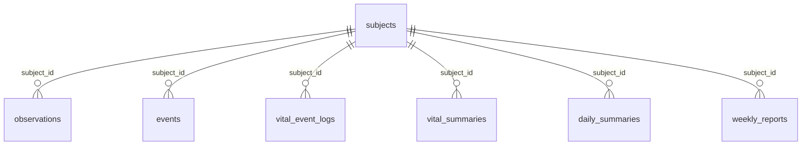

# PostgreSQL ERD와 데이터 사전

`capstone` 데이터베이스의 `public` 스키마를 pgAdmin에서 내보낸 모델을 기준으로 정리했다. pgAdmin ERD Tool에서 `capstone_postgresql.pgerd`를 열 수 있다.

## 테이블 관계

대상자 한 명은 각 기록 테이블에 0건 이상을 가질 수 있다. 각 기록은 필수 외래키 `subject_id`로 대상자 한 명에 연결된다. `events`는 사건의 시작과 종료를, `vital_event_logs`는 수신한 상세 기록을 저장한다. 현재 두 테이블은 각각 `subjects`에 연결되어 있다.

## 데이터 사전

PK는 기본키, FK는 외래키다. 다섯 테이블의 기본키는 `bigint`이며 PostgreSQL이 `IDENTITY`로 생성한다. `timestamptz`는 `timestamp with time zone`을 뜻한다.

### `subjects` · 대상자

| 컬럼 | 자료형 | 키 | NULL 허용 | 의미 |
|---|---|---|---|---|
| `subject_id` | `bigint` | PK | 아니요 | 대상자 번호 |
| `display_name` | `varchar(50)` | | 아니요 | 화면에 표시할 대상자 이름 |

### `observations` · 시각별 관측

| 컬럼 | 자료형 | 키 | NULL 허용 | 의미 |
|---|---|---|---|---|
| `observation_id` | `bigint` | PK | 아니요 | 관측 기록 번호 |
| `subject_id` | `bigint` | FK | 아니요 | `subjects.subject_id` |
| `observed_at` | `timestamptz` | | 아니요 | 관측 시각 |
| `breathing_rate_bpm` | `numeric(5,2)` | | 예 | 호흡수(회/분). 유효한 측정값이 없으면 NULL |
| `status` | `varchar(20)` | | 예 | 관측 시점의 상태 |

### `events` · 사건 이력

| 컬럼 | 자료형 | 키 | NULL 허용 | 의미 |
|---|---|---|---|---|
| `event_id` | `bigint` | PK | 아니요 | 사건 번호 |
| `subject_id` | `bigint` | FK | 아니요 | `subjects.subject_id` |
| `event_type` | `varchar(30)` | | 아니요 | 사건 유형 |
| `started_at` | `timestamptz` | | 아니요 | 사건 시작 시각 |
| `ended_at` | `timestamptz` | | 예 | 사건 종료 시각 |

### `vital_event_logs` · 수신 이벤트 상세 기록

| 컬럼 | 자료형 | 키 | NULL 허용 | 의미 |
|---|---|---|---|---|
| `log_id` | `bigint` | PK | 아니요 | 상세 기록 번호 |
| `subject_id` | `bigint` | FK | 아니요 | `subjects.subject_id` |
| `logged_at` | `timestamptz` | | 아니요 | 송신 메시지의 기록 시각 |
| `status_level` | `text` | | 아니요 | 수신한 상태 수준 |
| `event_type` | `text` | | 아니요 | 수신한 이벤트 유형 |
| `duration_sec` | `numeric` | | 예 | 송신 측이 기록한 지속 시간(초) |
| `breath_rate` | `numeric` | | 예 | 수신한 호흡수 |
| `heart_rate` | `numeric` | | 예 | 수신한 심박수 |
| `breath_deviation` | `numeric` | | 예 | 수신한 호흡 편차 |
| `location_x` | `numeric` | | 예 | 위치의 x 좌표 |
| `location_y` | `numeric` | | 예 | 위치의 y 좌표 |
| `location_z` | `numeric` | | 예 | 위치의 z 좌표 |
| `received_at` | `timestamptz` | | 아니요 | DB에 기록한 수신 시각. 기본값 `CURRENT_TIMESTAMP` |
| `source_id` | `text` | | 예 | 재전송을 구분하는 송신 장치 ID |
| `message_id` | `text` | | 예 | 장치에서 부여한 이벤트 메시지 ID |

### `vital_summaries` · 수신 주기별 요약

| 컬럼 | 자료형 | 키 | NULL 허용 | 의미 |
|---|---|---|---|---|
| `summary_id` | `bigint` | PK | 아니요 | 요약 기록 번호 |
| `subject_id` | `bigint` | FK | 아니요 | `subjects.subject_id` |
| `summary_at` | `timestamptz` | | 아니요 | 송신 메시지의 요약 시각 |
| `status_level` | `text` | | 아니요 | 요약 구간의 수신 상태 수준 |
| `period_seconds` | `integer` | | 아니요 | 요약 구간 길이(초) |
| `avg_breath_rate` | `numeric` | | 예 | 요약 구간 평균 호흡수 |
| `min_breath_rate` | `numeric` | | 예 | 요약 구간 최저 호흡수 |
| `max_breath_rate` | `numeric` | | 예 | 요약 구간 최고 호흡수 |
| `avg_heart_rate` | `numeric` | | 예 | 요약 구간 평균 심박수 |
| `active_time_sec` | `numeric` | | 예 | 요약 구간 내 활동 시간(초) |
| `valid_sample_count` | `integer` | | 예 | 요약 구간 내 유효 호흡 샘플 수 (0 이상) |
| `received_at` | `timestamptz` | | 아니요 | DB에 기록한 수신 시각. 기본값 `CURRENT_TIMESTAMP` |
| `source_id` | `text` | | 예 | 재전송을 구분하는 송신 장치 ID |
| `message_id` | `text` | | 예 | 장치에서 부여한 요약 메시지 ID |

두 수신 테이블은 각자 `(source_id, message_id)` 조합의 중복을 막는 `UNIQUE` 제약을 가진다. 두 ID는 함께 입력하거나 함께 생략한다. 같은 메시지를 다시 보내면 수신 API가 처음 저장한 기록 번호를 돌려준다.

### `daily_summaries` · 일일 집계 (365일 보관)

`sql/003_daily_weekly_retention.sql`로 생성한다. `(subject_id, summary_date, calc_version)` 유일성 제약으로 재집계 시 중복 없이 갱신(UPSERT)된다. 상세 로그·요약이 14일 후 삭제되더라도 주간 평균을 정확히 재계산할 수 있도록 가중합(`breath_rate_weighted_sum`)과 가중치 합(`breath_rate_weight`)을 함께 보존한다.

| 컬럼 | 자료형 | 키 | NULL 허용 | 의미 |
|---|---|---|---|---|
| `daily_summary_id` | `bigint` | PK | 아니요 | 일일 집계 번호 |
| `subject_id` | `bigint` | FK | 아니요 | `subjects.subject_id` |
| `summary_date` | `date` | | 아니요 | 한국 시간 기준 집계 날짜 |
| `calc_version` | `text` | | 아니요 | 집계 계산 버전 (기본값 `'v1'`) |
| `summary_count` | `integer` | | 아니요 | 해당 날짜에 수신한 `vital_summaries` 행 수 |
| `measured_seconds` | `integer` | | 아니요 | 유효 호흡 측정 구간 길이 합(초, 최대 86400) |
| `unmeasured_seconds` | `integer` | | 아니요 | 미측정 시간(초, `86400 - measured_seconds`) |
| `valid_sample_count` | `integer` | | 아니요 | 유효 호흡 샘플 수 합 |
| `breath_rate_weighted_sum` | `numeric` | | 예 | 주간 가중평균 재계산용 호흡수 가중합 |
| `breath_rate_weight` | `numeric` | | 아니요 | 가중치 합 (`valid_sample_count` 우선, 미전달 시 `period_seconds`) |
| `weighting_method` | `text` | | 아니요 | 가중 방식 (`valid_sample_count` / `period_seconds` / `mixed` / `none`) |
| `avg_breath_rate` | `numeric(5,2)` | | 예 | 일일 가중 평균 호흡수 |
| `min_breath_rate` | `numeric(5,2)` | | 예 | 일일 최저 호흡수 |
| `max_breath_rate` | `numeric(5,2)` | | 예 | 일일 최고 호흡수 |
| `active_time_sec` | `numeric` | | 예 | 일일 활동 시간 합(초) |
| `warning_log_count` | `integer` | | 아니요 | 일일 주의 로그 건수 |
| `emergency_log_count` | `integer` | | 아니요 | 일일 응급 로그 건수 |
| `warning_dawn_count` | `integer` | | 아니요 | 새벽(00~06시) 주의 로그 건수 |
| `warning_day_count` | `integer` | | 아니요 | 낮(06~18시) 주의 로그 건수 |
| `warning_night_count` | `integer` | | 아니요 | 밤(18~24시) 주의 로그 건수 |
| `detail_pruned_at` | `timestamptz` | | 예 | 해당 날짜의 상세 데이터가 삭제·마감된 시각. `NOT NULL`이면 지연 패킷으로 덮어쓰지 않음 |
| `updated_at` | `timestamptz` | | 아니요 | 마지막 집계 갱신 시각 |

### `weekly_reports` · 주간 건강 리포트 (365일 보관)

`sql/003_daily_weekly_retention.sql`로 생성한다. `(subject_id, report_date, calc_version)` 유일성 제약으로 같은 기준일 재실행 시 멱등 갱신된다.

| 컬럼 | 자료형 | 키 | NULL 허용 | 의미 |
|---|---|---|---|---|
| `report_id` | `bigint` | PK | 아니요 | 주간 리포트 번호 |
| `subject_id` | `bigint` | FK | 아니요 | `subjects.subject_id` |
| `report_date` | `date` | | 아니요 | 비교 기준일 (KST) |
| `prev_start_date` / `prev_end_date` | `date` | | 아니요 | 직전 7일 기간 |
| `recent_start_date` / `recent_end_date` | `date` | | 아니요 | 최근 7일 기간 |
| `calc_version` | `text` | | 아니요 | 리포트 계산 버전 (기본값 `'v1'`) |
| `comparison_status` | `text` | | 아니요 | 비교 상태 (`ready` / `insufficient_observations`) |
| `prev_avg_breath_rate` / `recent_avg_breath_rate` / `breath_rate_change_bpm` | `numeric(5,2)` | | 예 | 직전/최근 가중 평균 호흡수 및 변화량 |
| `prev_avg_daily_activity_sec` / `recent_avg_daily_activity_sec` | `numeric` | | 예 | 직전/최근 일평균 활동 시간(초) |
| `prev_warning_count` / `recent_warning_count` | `integer` | | 아니요 | 직전/최근 주의 로그 건수 |
| `prev_emergency_count` / `recent_emergency_count` | `integer` | | 아니요 | 직전/최근 응급 로그 건수 |
| `report_payload` | `jsonb` | | 아니요 | 일별 추이·시간대 분포·미측정 시간·자동 소견을 포함한 전체 리포트 JSON |
| `generated_at` | `timestamptz` | | 아니요 | 리포트 생성 시각 (365일 보관 만료 기준) |

## 현재 사용 경로

| 처리 | 테이블 |
|---|---|
| `POST /api/v1/vital-events` | `vital_event_logs`에 추가 (14일 보관) |
| `POST /api/v1/vital-summary` | `vital_summaries`에 추가 (14일 보관) |
| `GET /api/v1/summary-report`, `summary_report.py` | `vital_summaries`·`vital_event_logs` 및 `daily_summaries` 가중평균 조회 |
| `GET /api/v1/weekly-reports` | `weekly_reports` 장기 보관 리포트 조회 (365일 보관) |
| `retention_batch.py` | 완료일 `daily_summaries` 롤업 + 주간 리포트 저장 + 14일/365일 만료 삭제 |
| 시연용 일일 호흡 집계와 Python 비교 리포트 | `observations`에서 조회 |
